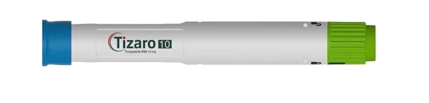
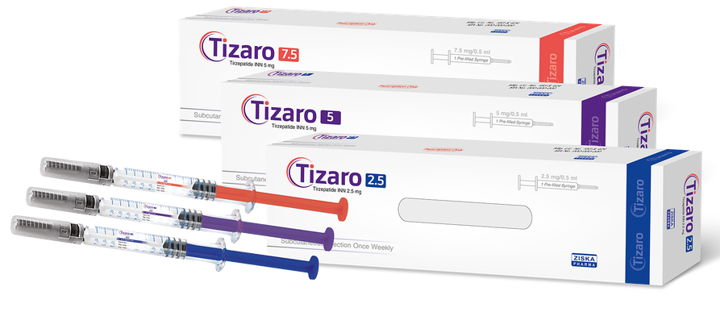
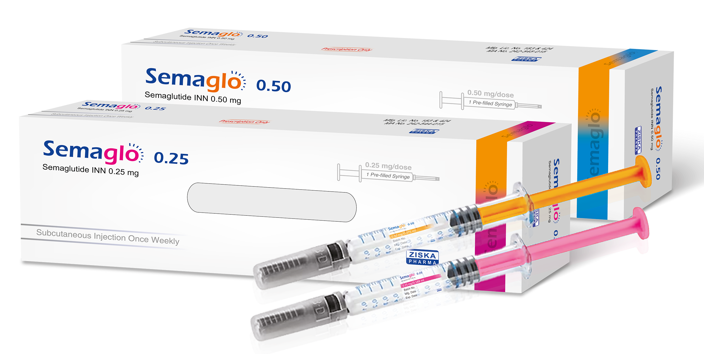
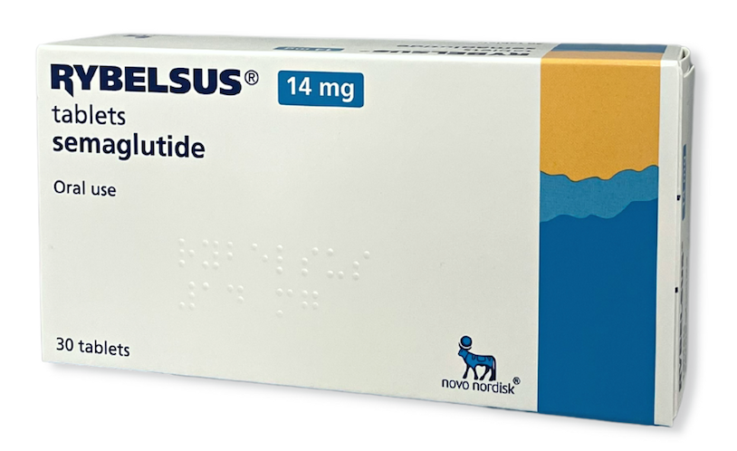
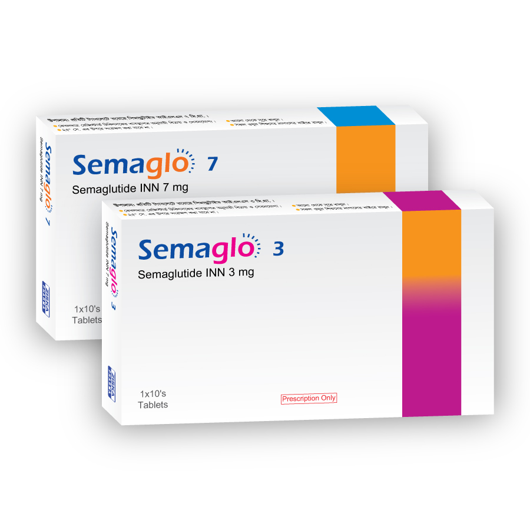
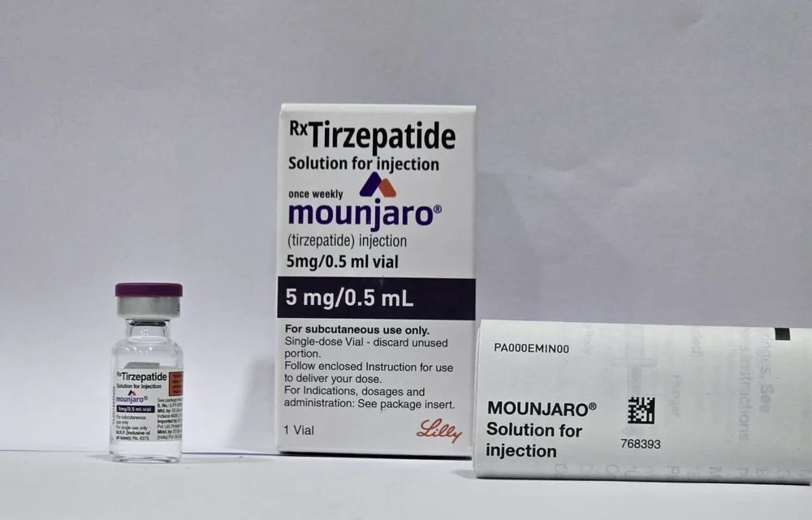
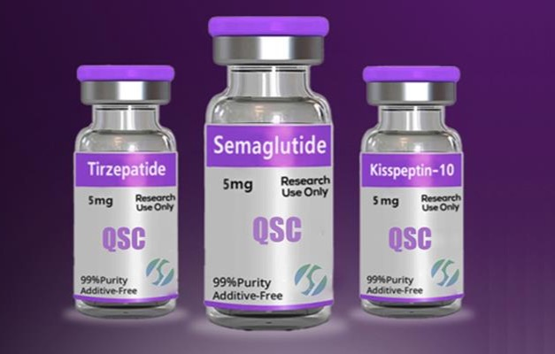

This section outlines the three main approaches discussed. Understanding the characteristics, requirements, and risks of each path is essential before you proceed. Decide which route matches your budget, skill level, and risk tolerance.

---

## Jump to your path: {#-jump-to-your-path}

- **[Path A: Ready-to-Use](/path-guides/path-a-ready-to-use)** – pens, pre-filled syringes, tablets (minimal preparation)
- **[Path B: Authentic Vial](/path-guides/path-b-authentic-vial)** – branded single-dose vials shipped from India
- **[Path C: DIY Powder](/path-guides/path-c-diy-powder)** – lowest cost, highest risk, requires home reconstitution

---

## Option A: (Pen, Pre-filled Syringe, Tablet)

This option includes GLP-1 products sold as ready-to-use pens, single-dose syringes, or tablets. They need almost no preparation and are often imported through gray-market channels that bypass local prescription requirements.

<Tabs>
  <Tab title="Single-Use Injector Pens" icon="pen-fancy">
    **Single-Use Injector Pens (Tirzepatide)**

    <Frame>
      
    </Frame>

    The "Tizaro" pen (tirzepatide) from Ziska Pharmaceuticals, shipped via India, delivers one weekly dose per pen. Operation is straightforward, but the supply chain is not formally regulated.
  </Tab>
  <Tab title="Pre-filled Syringes" icon="syringe">
    **Pre-filled Syringes (Tirzepatide)**

    <Frame>
      
    </Frame>

    The "Tizaro" pre-filled syringe from Ziska Pharmaceuticals contains a single weekly dose that is ready for immediate injection.

    **Pre-filled Syringes (Semaglutide)**

    <Frame>
      
    </Frame>

    The "Semaglo" pre-filled syringe from Ziska Pharmaceuticals contains a single weekly dose that is ready for immediate injection.
  </Tab>
  <Tab title="Oral Tablets" icon="pills">
    **Oral Tablets (Semaglutide)**

    <Frame>
      
    </Frame>

    Rybelsus® tablets (semaglutide) from Novo Nordisk are legally approved but often imported through gray-market suppliers to lower costs or bypass access barriers.

    **Oral Tablets (Semaglutide)**

    <Frame>
      
    </Frame>

    Semaglo tablets (semaglutide) from Ziska Pharmaceuticals are legally approved but often imported through gray-market suppliers to lower costs or bypass access barriers.
  </Tab>
</Tabs>

### Who is this for?

- People who want the simplest setup with almost no preparation
- Users willing to handle the uncertainties of gray-market shipping
- Anyone who prefers to avoid mixing or measuring doses

## Option B: (Mounjaro® Tirzepatide Vial)

<Frame caption="Mounjaro® (tirzepatide) single-dose vial – Eli Lilly India">
  
</Frame>

Indian-market Mounjaro vials are manufactured by Eli Lilly and use the same serialised packaging as US products. You can confirm authenticity with `scan.lilly.com`. Thanks to purchasing-power parity, the price per vial is lower in India, making this the safest and most cost-effective gray-market choice.

Vials are available only in 2.5 mg and 5 mg strengths. If you need a larger dose such as 10 mg, buy two 5 mg vials and inject both. Each vial is single use, so no dose measurement is required – draw the entire contents into a syringe and inject once.

### Who is this for?

- People who want authentic branded medication from the gray market
- Those seeking lower prices than domestic pharmacies
- Users willing to manage international shipping and inject a single-dose vial

## Option C: The DIY Powder (Lyophilized Peptides)

<Frame caption='Lyophilized peptide powder labelled "Research Use Only"'>
  
</Frame>

This route buys semaglutide or tirzepatide as freeze-dried powder from online "research chemical" vendors. Labels state **"for research use only"** and **not for human use**.

#### You must master several technical steps:

- <Icon icon="flask" /> **Reconstitution:** Mix the powder with sterile bacteriostatic water without contaminating it.
- <Icon icon="calculator" /> **Dosage Calculation:** Work out the exact volume to inject. A small math error can cause severe over- or under-dosing.
- <Icon icon="syringe" /> **Drawing and Injecting:** Pull the measured dose into an insulin syringe and give the shot subcutaneously.

Per-dose cost is lowest, but hazards are highest – unknown purity, sterility, and potency, plus a much larger chance of user error. Independent lab testing is expensive and rarely performed.

### Who is this for?

- People chasing the lowest possible cost and willing to shoulder serious risk
- Users prepared to research, calculate, and follow strict sterile technique
- Those comfortable sourcing supplies, mixing solutions, and performing their own injections

<Danger>
**This path is dangerous** because the product is unverified and the procedure is complex
</Danger>

## GLP-1 Options Overview

<Columns cols={3}>
  <Card title="Path A · Ready-to-Use" icon="pen-clip" href="/path-guides/path-a-ready-to-use">
    Pre-filled pens or tablets

    - **Form:** Pen / Tablet
    - **Ease:** ★★★★★
    - **Cost:** $150–250
    - **Mixing:** No
    - **Calculation:** No
  </Card>
  <Card title="Path B · Authentic Vial" icon="vial" href="/path-guides/path-b-authentic-vial">
    Manufacturer vial, draw dose

    - **Form:** Vial
    - **Ease:** ★★★☆☆
    - **Cost:** ~$200
    - **Mixing:** No
    - **Calculation:** Yes
  </Card>
  <Card title="Path C · DIY Powder" icon="flask" href="/path-guides/path-c-diy-powder">
    Freeze-dried powder, high risk

    - **Form:** Powder
    - **Ease:** ★☆☆☆☆
    - **Cost:** ~$100*
    - **Mixing:** Yes
    - **Calculation:** Yes
  </Card>
</Columns>

<Note>
**Looking for suppliers?** Check our [Verified Vendors](/sourcing-details/verified-vendors) directory for community-reviewed options.
</Note>
